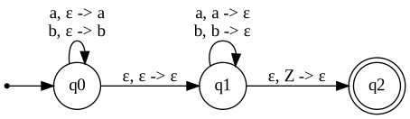

# Course: 21CSC301T Formal Language and Automata, CLA-2, Assessment Task 3

### Summary Table

| Case study | Grammar | PDA | Deterministic? |
| :--- | :--- | :--- | :--- |
| Balanced brackets | Ambiguous $S\rightarrow SS\vert{}(S)\vert{}\epsilon$ | 3-state DPDA | Yes |
| Arithmetic expression validation | Ambiguous $E\rightarrow E+E\vert{}E*E\vert{}(E)\vert{}id$ | CFG-PDA construction + predictive parser | Yes |
| Palindrome checker | Unmarked: $S\rightarrow aSa\vert{}bSb\vert{}a\vert{}b\vert{}\epsilon$ | NPDA (runs on $ww^R$) / DPDA (on $wcw^R$) | No |

### Run Commands
Run the test suites with CLI arguments:
```bash
python task3_pda_cfg.py
```

### Section - Why finite automata are not enough
Finite Automata lack an unbounded memory mechanism. By the Pumping Lemma, for nested language $L = \{(^n)^n : n \ge 1\}$, pumping any candidate string splits $s = xyz$ such that $xy^2z = (^{p+k})^{p}$ which violates the nested criteria.

### Section 1. Balanced brackets
Matches brackets deterministically by using a DPDA pushing `(` and popping on `)`. 


### Section 2. Arithmetic expressions
Eliminates mathematical derivation ambiguities by enforcing left-recursive precedence order using predictive parsing LL(1) tables.


### Section 3. Palindromes
Shows the contrast between marked $wcw^R$ (DPDA) and unmarked $ww^R$ (NPDA) requiring structural middle-guessing transitions.

