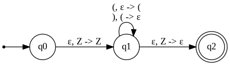
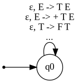
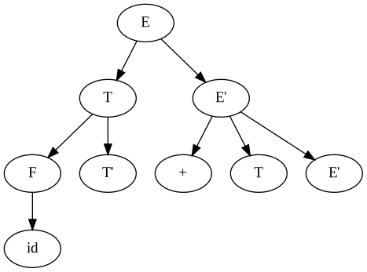

# Case Studies with Pushdown Automata and Context-Free Grammars

### Course Details
* **Course:** 21CSC301T Formal Language and Automata, CLA-2, Assessment Task 3
* **Student:** Niranjan R (RA2411026050070), B.Tech AIML 'A', III year
* **Faculty:** Dr. C. Gunasundari, SRM IST Tiruchirappalli

---

## 1. Case Studies with Pushdown Automata and Context-Free Grammars
There are three case studies. Each one has a Context-Free Grammar (CFG), a Pushdown Automaton (PDA), derivations and stack moves, accepted/rejected strings, and a discussion of ambiguity and determinism.

### Summary Table
| Case study | Grammar | PDA | Deterministic? |
| :--- | :--- | :--- | :--- |
| Balanced brackets | Ambiguous $S\rightarrow SS\vert{}(S)\vert{}\epsilon$ | 3-state DPDA | Yes |
| Arithmetic expression | Ambiguous $E\rightarrow E+E\vert{}E*E\vert{}(E)\vert{}id$ | CFG-PDA (predictive parser) | Yes |
| Palindromes | Unmarked: $S\rightarrow aSa\vert{}bSb\vert{}a\vert{}b\vert{}\epsilon$ | NPDA (runs on $ww^R$) | No |

---

## 2. Run It
To execute the verification test suites and display parsing and stack state transition traces, run:
```bash
python task3_pda_cfg.py
```

---

## 3. Why Finite Automata Are Not Enough
Finite Automata lack an unbounded memory mechanism. By the Pumping Lemma, for nested language $L = \{(^n)^n : n \ge 1\}$, pumping any candidate string splits $s = xyz$ such that $xy^2z = (^{p+k})^{p}$ which violates the matched nested criteria.

---

## 4. Balanced Brackets
This application validates brackets structures. Our simulation traces the exact derivations and state configurations of the stack sequentially.

### 5. DPDA (accepts by final state):
We implement a 3-state deterministic PDA:
* **q0 (Start State):** Sets up the stack boundary marker $Z$.
* **q1 (Processing State):** Pushes opening brackets onto the stack, and pops them upon encountering closing brackets.
* **q2 (Accept State):** Transition on empty/clean stack $Z$ upon reading string end.



---

## 6. Arithmetic Expression
Eliminates parsing ambiguity of mathematical operators (`id+id*id`) by restructuring the CFG to enforce operator precedence using predictive LL(1) parsing tables.




---

## 7. Palindromes
Contrasts marked palindromes $wcw^R$ (DPDA) with unmarked palindromes $ww^R$ (NPDA) where state machines guess the midpoint of strings using non-deterministic epsilon transitions.


---

## 8. Layout
The layout and programmatic design diagrams are designed using the Python `graphviz` library and exported as clean visual models for direct rendering.
